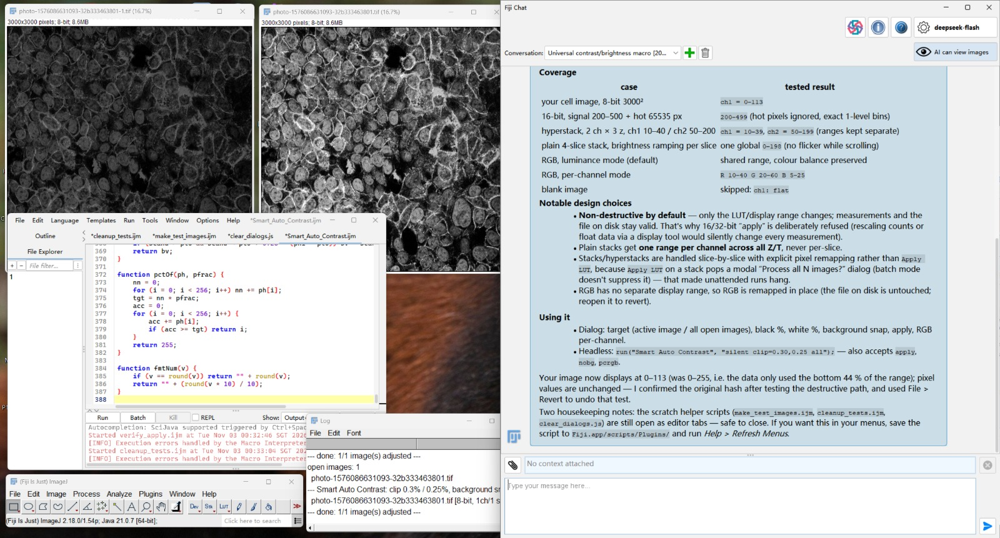
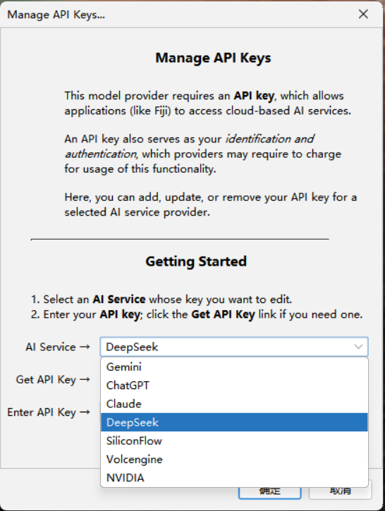
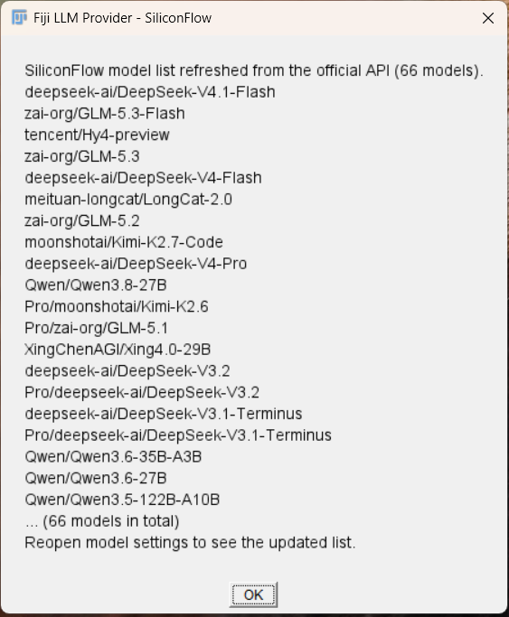
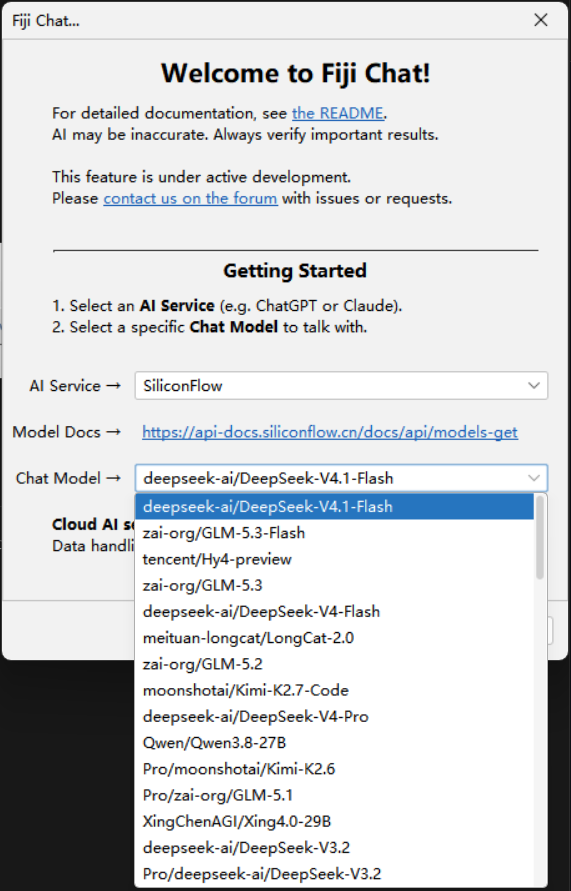
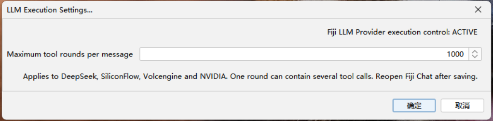

# Fiji LLM Provider

**English** | [简体中文](README.zh-CN.md)

Add **DeepSeek, SiliconFlow, Volcengine Ark and NVIDIA** to
[Fiji Chat](https://github.com/fiji/fiji-llm) with one extension JAR.

The extension discovers model IDs from each service, uses Fiji Chat's existing
API-key manager, and provides a configurable assistant tool-round limit with a
default of **1000 rounds per user message**. It extends Fiji Chat through SciJava
services; it does not replace the original Fiji Chat JAR.

**Current version: 0.5.9.** This is an independent extension, not an official
release from Fiji or any model provider.


Version 0.5.9 fixes a remaining wait for idle ordinary executor workers after a macro finishes. It also adds stable dialog/control IDs, committed numeric input, command-parameter discovery and tracked image closure. See [Automation compatibility](docs/AUTOMATION.md).

Version 0.5.8 presents ongoing work in three parts: public progress in the
chat body, the existing collapsible activity log, and a separately headed final
report. A new assistant-local reporting tool publishes milestones without a
separate summarization request. See [Chat presentation](docs/CHAT-DISPLAY.md).

Version 0.5.7 fixes a remaining Cellpose completion wait in 0.5.6. Shared JVM
parallel workers can inherit a macro's thread group and stay alive after their
work finishes. The extension now recognizes idle common-pool workers by their
actual pool and wait stack, while still waiting for active work and ordinary
macro child threads. Idle ImageJ stack-window selector loops are also recognized
by their actual wait stack. Other script languages retain the original service.
See [Macro execution compatibility](docs/MACRO-EXECUTION.md).

The context monitoring, task retention, automatic compaction and recovery
features from 0.5.5 are retained. See [Context and recovery](docs/CONTEXT.md).

See the [0.5.9 notes](docs/releases/v0.5.9.md) and [verification](docs/VERIFICATION.md). The 0.5.8 release notes remain available in the release history.

## Example workflow

Fiji Chat using **DeepSeek Flash** to create and test an ImageJ macro for
brightness and contrast adjustment. The screenshot shows the image before
adjustment (left), the adjusted display (center), and the macro editor and
assistant conversation.

[](docs/fiji-chat-contrast-brightness-demo.png)

*Click the image to view the full-resolution screenshot.*

## Features

- Four hosted providers in Fiji Chat's model chooser.
- Dynamic model lists, with cached results when refresh temporarily fails.
- Manual model / inference endpoint entry for Volcengine Ark.
- Shared response timeout configuration for long model requests.
- Multimodal message handling and image-tool normalization where required.
- A configurable tool-calling round limit for the four added providers.
- Eighteen local verification suites requiring no live API key, plus optional real macro/Cellpose integration checks.

| Provider | API base | Protocol | Model discovery |
| --- | --- | --- | --- |
| DeepSeek | `https://api.deepseek.com` | Responses | `GET /models` |
| SiliconFlow | `https://api.siliconflow.cn/v1` | Chat Completions | `GET /models?sub_type=chat` |
| Volcengine Ark | `https://ark.cn-beijing.volces.com/api/v3` | Chat Completions | `GET /models`, plus manual model / endpoint ID |
| NVIDIA | `https://integrate.api.nvidia.com/v1` | Chat Completions | `GET /models` |

## Interface preview

**Provider selection and dynamic model lists.** Fiji Chat's API-key manager
includes DeepSeek, SiliconFlow, Volcengine and NVIDIA. The model-refresh dialog
shows models retrieved from the provider's API; the SiliconFlow screenshot
captured 66 models. Model names and counts can change as the service is updated.

**How to refresh the model list:** In Fiji's main menu, choose
**Help → Assistants → Refresh LLM Models...**, select the API provider, and
refresh. Unlock the API-key vault if prompted. When the refresh finishes,
reopen Fiji Chat's model chooser to see the updated list.

<p>
  <a href="docs/manage-api-keys-providers.png"></a>
  <a href="docs/siliconflow-dynamic-model-list.png"></a>
</p>

**Choose a model from your provider.** After refreshing, reopen Fiji Chat's model
chooser. You can select any compatible chat model available through your
provider and account, across the model families in its catalog. The list is
fetched dynamically and is not limited to the models recommended below.

<p>
  <a href="docs/siliconflow-model-selection.png"></a>
</p>

**Check model capabilities.** Not every model in a provider's catalog supports
vision or tool calling. Fiji actions require **tool/function calling**; sending
images requires **vision/image input**. A workflow that combines both needs a
model and provider endpoint that support both. Consult the provider's model card
and capability documentation, such as SiliconFlow's
[function calling](https://docs.siliconflow.cn/docs/userguide/guides/function-calling)
and [multimodal input](https://docs.siliconflow.cn/docs/userguide/capabilities/multimodal-vision) guides.

**Author-tested recommendations (2026-11-03):**

- **DeepSeek V4.1 Flash** — SiliconFlow ID: `deepseek-ai/DeepSeek-V4.1-Flash`.
- **GLM 5.3 Flash** — SiliconFlow ID: `zai-org/GLM-5.3-Flash`.

These recommendations reflect the author's Fiji Chat testing. Model IDs and
capabilities can differ between providers; use the current catalog and the
specific provider's model documentation.

**Execution settings.** The extension reports **ACTIVE**, with the maximum set
to **1000 tool-calling rounds per message**. One round can contain several tool
calls. Save the setting and reopen Fiji Chat to apply it to an existing chat.

[](docs/llm-execution-settings-1000.png)

*Click any screenshot to view it at full resolution.*

## Requirements

You need a working **Fiji installation with Fiji Chat installed**, plus an API key
for each hosted service you intend to use. A model must support tool/function
calling to perform Fiji actions; image input additionally requires a suitable
vision-capable model.

The verified environment is Windows 11, Fiji/ImageJ 2.18.0 / ImageJ 1.54p,
Fiji Chat `0.2.0-SNAPSHOT`, Java 21.0.7, and LangChain4j 1.21.0. The extension is
compiled for Java 17, but that does not establish compatibility with other Fiji
dependency sets or operating systems. See [compatibility and verification](docs/VERIFICATION.md).

## Installation

1. Install Fiji Chat first. Follow the upstream
   [Fiji Chat Quick Start](https://github.com/fiji/fiji-llm#fiji-chat-quick-start).
   It currently uses the `Fiji-chat` update site at
   `https://sites.imagej.net/Fiji-chat/`.
2. Save your work and **close Fiji**.
3. Download `fiji-llm-provider-0.5.9.jar` from the [Releases page](https://github.com/liuhaoqiu/fiji-llm-provider/releases).
   Optionally compare its SHA-256 with `SHA256SUMS.txt` in the same release.
4. Copy the JAR into the **`jars` directory inside your Fiji installation**.
   Do not replace `fiji-llm-*.jar`, which belongs to Fiji Chat itself.
5. If upgrading, move older `fiji-llm-provider-*.jar` or
   `fiji-deepseek-provider-*.jar` files out of `jars`, or rename them so they no
   longer end in `.jar`. Keep only one active extension version.
6. Restart Fiji. Under **Help > Assistants**, confirm that **Refresh LLM Models...**
   and **LLM Execution Settings...** are available.

The JAR is the installable artifact. You do not need to compile or install the
source ZIP to use it. Detailed instructions are in [Installation](docs/INSTALLATION.md).

## First use

1. Open **Help > Assistants > Manage API Keys...**.
2. Select **DeepSeek**, **SiliconFlow**, **Volcengine**, or **NVIDIA**, and save the
   API key issued by that service. The vault unlock password is different from
   a provider API key.
3. Open **Help > Assistants > Refresh LLM Models...**, select the same provider,
   and refresh. Unlock the key vault if prompted.
4. Open **Help > Assistants > Fiji Chat...**. Choose the provider and a model,
   or use the chat window's gear button to change an existing selection.
5. Open an image or script in Fiji and ask the assistant to work with it. For
   example: “Inspect the active image and suggest suitable brightness and
   contrast settings.”

After refreshing, reopen the model chooser to see the updated list. To send
images, enable Fiji Chat's image-sharing control and select a model supporting
image input. The image-sharing control is not a guarantee of model capability.

For Ark endpoint IDs, NVIDIA catalog caveats and example workflows, see
[Usage](docs/USAGE.md).

## Tool-round limit

Open **Help > Assistants > LLM Execution Settings...**.

- The default in **0.5.9 is 1000 rounds per user message**.
- You can save any positive integer appropriate to your task.
- One model reply containing several tool calls counts as **one round**. The
  displayed tool-use count can therefore differ from the round count.
- Reopen Fiji Chat after saving to apply the setting to an existing chat window.
  A running request keeps the budget with which it started.
- A new user message gets a fresh budget. Reaching the limit still ends the
  current invocation. Context-size failures preserve a progress checkpoint for continuation.

Existing saved settings take priority over the new default. If you previously
saved 300 in version 0.5.0, set 1000 in the menu to adopt the new value. The menu
should report **Fiji LLM Provider execution control: ACTIVE**. Other providers,
including the built-in ChatGPT, Claude, Gemini and Ollama integrations, continue
to use the original Fiji Chat assistant service.

## Context window, monitoring and recovery

Open **Help > Assistants > LLM Execution Settings...**. Set the context window to
**0** to use model metadata, **524288** for 512K, or **1048576** for 1M. Known
model limits still apply. Output tokens are reserved separately; the default
reserve is 65,536, clamped to the model and selected window.

Open **Help > Assistants > LLM Context Status...** for a live, once-per-second
view of estimated input tokens, actual serialized request bytes and the input
usage reported by the last completed API response. Token estimates and measured
HTTP bytes are separate. DeepSeek's default request-body cap is 48 MiB.

Old context is organized into extractive excerpts before it grows too large.
Full messages and received streaming progress remain in a local archive. If a
context-size error still occurs, the chat shows a **Task paused — not completed**
checkpoint instead of rolling back its progress. Reply **continue** in the same
chat. This does not automatically replay completed tools or restore an external
process after restarting Fiji. See [Context budgets and recovery](docs/CONTEXT.md).

## Timeouts

All four providers configure a 30-minute model-response wait and a separate
15-second connection timeout. Model-list requests use a 5-second timeout.
These are client settings for individual requests, not a guarantee that a
provider will keep a request alive or finish a task. Server-side limits, HTTP
errors, network failures and the tool-round budget are separate concerns.

## Updating Fiji Chat

The extension and its saved preferences are separate from the Fiji Chat JAR.
Replacing the core JAR alone does not reset the configured round limit. However,
changes to Fiji Chat or LangChain4j interfaces can require an extension update.
The ACTIVE indicator confirms service selection, not compatibility with every
future upstream behavior. Rebuild and rerun the tests after a core upgrade.

## Build from source

On Windows, use **PowerShell 7** and **JDK 21 or newer** with an existing compatible
Fiji installation. No Maven repository, API key or live inference request is
required by the build.

```powershell
pwsh -NoProfile -File .\build.ps1 -FijiRoot "C:\path\to\Fiji"
```

If the bundled JDK cannot be found, supply it explicitly:

```powershell
pwsh -NoProfile -File .\build.ps1 -FijiRoot "C:\path\to\Fiji" -JdkHome "C:\path\to\jdk-21"
```

The script compiles against Fiji's installed JARs, runs all eighteen verification
suites, and writes `build/fiji-llm-provider-0.5.9.jar` only after they pass.
The timeout suite deliberately waits at least 65 seconds. Tests use local
servers and synthetic models/tools; they do not process your open images or
change your saved tool-round preference. See [Building](docs/BUILDING.md).

## Troubleshooting and contributions

See [Troubleshooting](docs/TROUBLESHOOTING.md), [implementation notes](docs/DEVELOPMENT.md)
and [the changelog](CHANGELOG.md). When reporting an issue, include the extension,
Fiji Chat and Java versions, provider name and sanitized error text. Do not include
API keys, vault passwords, conversation exports or private images.

## License

[PolyForm Noncommercial 1.0.0](LICENSE.txt) for original extension contributions.
This source-available release permits the purposes defined in that license; it
does not add a requirement to publish downstream source code. Read the explicit
permissions for educational and other listed organizations in the license.

Assistant builder wiring adapted from [Fiji LLM](https://github.com/fiji/fiji-llm)
retains its upstream BSD 2-Clause notice. Dependencies are not bundled. See
[Licensing](docs/LICENSING.md) and [NOTICE.txt](NOTICE.txt) for scope and attribution.
