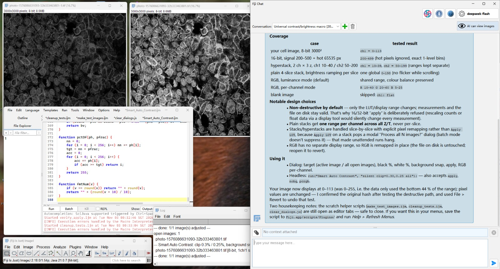
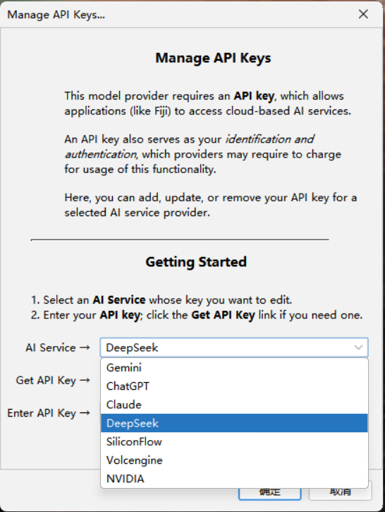
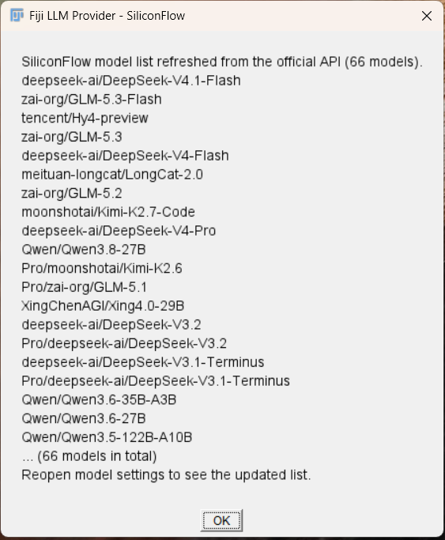
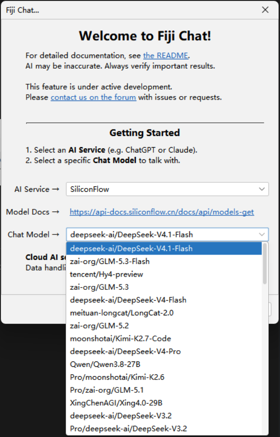
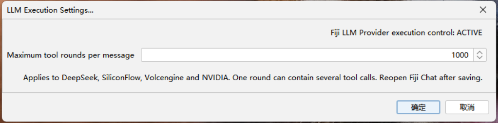

# Fiji LLM Provider

[English](README.md) | **简体中文**

一个扩展 JAR，为 [Fiji Chat](https://github.com/fiji/fiji-llm) 添加
**DeepSeek、硅基流动 SiliconFlow、火山引擎 Volcengine Ark 和 NVIDIA**。

插件从服务端动态获取模型 ID，沿用 Fiji Chat 的 API 密钥管理器，并提供可设置的
助手工具调用轮数上限，默认 **每条用户消息 1000 轮**。它通过 SciJava 服务扩展
Fiji Chat，无须替换原版 Fiji Chat JAR。

**当前版本：0.5.8。** 这是独立扩展，不是 Fiji 或模型服务商的官方发行版。

0.5.8 将展示分成三部分：正文中的阶段进展、原有的折叠运行日志，以及独立标题下的最终报告。
新增助手内的阶段汇报工具，可发布关键进展，无须额外发起模型总结请求。
详见[聊天展示说明](docs/zh-CN/CHAT-DISPLAY.md)。

0.5.7 修复 0.5.6 中残留的 Cellpose 收尾等待：JVM 共享并行工作线程可能继承宏的线程组，
计算完成后仍长期待命。插件根据真实线程池和等待栈识别这些空闲线程，继续等待仍在执行的工作
及普通宏子线程；同时根据真实等待栈识别 ImageJ 多通道窗口的空闲层选择器。
其他脚本语言仍使用原执行服务。
详见[宏执行兼容说明](docs/zh-CN/MACRO-EXECUTION.md)。

保留 0.5.5 的上下文监测、任务保留、自动整理和中断恢复。详见[上下文与恢复](docs/zh-CN/CONTEXT.md)。

详见[0.5.8 发布说明](docs/releases/v0.5.8.zh-CN.md)，包含尚待处理的线程池等待与同名对话框限制。

## 使用示例

在 Fiji Chat 中使用 **DeepSeek Flash** 编写并测试调整亮度和对比度的 ImageJ 宏。
截图展示了调整前的图像（左）、调整后的显示效果（中），以及宏编辑器和助手对话。

*点击图片可查看原尺寸截图。*

## 功能

- 在 Fiji Chat 模型选择器中添加四个服务商。
- 动态获取模型列表，刷新临时失败时保留缓存。
- 火山引擎支持手动填写模型 ID 或推理接入点 ID。
- 为耗时模型请求统一配置响应超时。
- 兼容多模态消息，并在需要时规范化图像工具结果。
- 可调整这四个服务商的助手工具调用轮数上限。
- 附带十六组本地验证，无须真实 API 密钥。

| 服务商 | API 地址 | 协议 | 模型获取方式 |
| --- | --- | --- | --- |
| DeepSeek | https://api.deepseek.com | Responses | GET /models |
| SiliconFlow | https://api.siliconflow.cn/v1 | Chat Completions | GET /models?sub_type=chat |
| Volcengine Ark | https://ark.cn-beijing.volces.com/api/v3 | Chat Completions | GET /models，另支持手动输入模型或接入点 ID |
| NVIDIA | https://integrate.api.nvidia.com/v1 | Chat Completions | GET /models |

## 界面展示

**服务商选择与动态模型列表。** Fiji Chat 的 API 密钥管理器中可选择 DeepSeek、
SiliconFlow、Volcengine 和 NVIDIA。刷新窗口展示从服务商 API 获取的模型；
硅基流动截图中当时返回了 66 个模型，模型名称和数量会随服务端更新而变化。

**更新模型列表的方法：** 在 Fiji 主窗口菜单依次选择
**Help → Assistants → Refresh LLM Models...**，选择 API 服务商并刷新；
如有提示，解锁 API 密钥库。刷新完成后，重新打开 Fiji Chat 的模型选择窗口，
即可看到更新后的模型列表。

  
  

**选择服务商提供的模型。** 刷新后重新打开 Fiji Chat 的模型选择窗口，即可选择
该服务商提供、当前账号有权调用且兼容聊天接口的各系列模型。模型列表动态获取，
不限于下面推荐的两款模型。

  

**注意模型能力差异。** API 供应商并非所有模型都支持视觉或工具调用。
执行 Fiji 操作需要模型支持 **工具调用/函数调用**；发送图像需要支持 **视觉/图像输入**。
同时需要看图并执行操作的任务，应选择模型和服务端接口均支持这两项能力的组合。
请查阅服务商的模型说明和能力文档，例如硅基流动的
[工具调用](https://docs.siliconflow.cn/docs/userguide/guides/function-calling)与
[多模态输入](https://docs.siliconflow.cn/docs/userguide/capabilities/multimodal-vision)说明。

**作者已实测并推荐（2026-11-03）：**

- **DeepSeek V4.1 Flash**：硅基流动模型 ID 为 `deepseek-ai/DeepSeek-V4.1-Flash`。
- **GLM 5.3 Flash**：硅基流动模型 ID 为 `zai-org/GLM-5.3-Flash`。

以上推荐来自作者在 Fiji Chat 中的实际使用测试。同名模型在不同服务商处的 ID
和能力可能不同，请以最新模型列表及对应服务商的模型说明为准。

**执行设置。** 窗口显示扩展已生效（**ACTIVE**），上限设为
**每条用户消息 1000 轮工具调用**。一轮可以包含多个工具调用。
保存后重新打开 Fiji Chat，使已有聊天窗口采用新设置。

*点击任意截图可查看原尺寸图片。*

## 环境要求

需要已安装 **Fiji Chat 的 Fiji**，以及所用服务商的 API 密钥。要让助手执行 Fiji
操作，模型必须支持工具调用或函数调用；要查看图像，还需要模型支持图像输入。

已验证环境：Windows 11、Fiji/ImageJ 2.18.0 / ImageJ 1.54p、
Fiji Chat 0.2.0-SNAPSHOT、Java 21.0.7、LangChain4j 1.21.0。
插件编译目标是 Java 17，但这不代表其他依赖组合或操作系统已经验证兼容。
详见[兼容性和验证记录](docs/zh-CN/VERIFICATION.md)。

## 安装

1. 先按上游 [Fiji Chat Quick Start](https://github.com/fiji/fiji-llm#fiji-chat-quick-start)
   安装 Fiji Chat。目前使用名为 Fiji-chat 的更新站点：
   https://sites.imagej.net/Fiji-chat/ 。
2. 保存工作并正常关闭 Fiji。
3. 从 [Releases 页面](https://github.com/liuhaoqiu/fiji-llm-provider/releases)
   下载 fiji-llm-provider-0.5.8.jar。可用同版本 SHA256SUMS.txt 核对文件。
4. 把 JAR 放入 **Fiji 安装目录中的 jars 文件夹**。
   保留属于 Fiji Chat 本体的 fiji-llm-*.jar。
5. 升级时将旧版 fiji-llm-provider-*.jar 或 fiji-deepseek-provider-*.jar
   移出 jars，或改名使其不再以 .jar 结尾。只启用一个扩展版本。
6. 重启 Fiji，在 **Help > Assistants** 下确认出现
   **Refresh LLM Models...** 和 **LLM Execution Settings...**。

普通用户只需安装 JAR，不需要编译或安装源码 ZIP。详细步骤见
[安装与升级](docs/zh-CN/INSTALLATION.md)。

## 首次使用

1. 打开 **Help > Assistants > Manage API Keys...**。
2. 选择 DeepSeek、SiliconFlow、Volcengine 或 NVIDIA，保存对应服务商的 API 密钥。
   密钥库的解锁密码不是 API 密钥。
3. 打开 **Help > Assistants > Refresh LLM Models...**，选择同一服务并刷新；
   如有提示，解锁密钥库。
4. 打开 **Help > Assistants > Fiji Chat...**，选择服务商和模型；
   已有聊天窗口可通过齿轮按钮修改选择。
5. 在 Fiji 中打开图像或脚本，然后描述任务，例如：
   “检查当前图像，建议合适的亮度和对比度设置。”

刷新后重新打开模型选择器，查看更新后的列表。发送图像时需开启聊天窗口的
图像共享开关，并选择支持图像输入的模型；该开关不代表模型一定具有视觉能力。
火山引擎接入点、NVIDIA 模型选择及示例见[使用指南](docs/zh-CN/USAGE.md)。

## 工具调用轮数上限

打开 **Help > Assistants > LLM Execution Settings...**：

- 0.5.8 的默认值为 **每条用户消息 1000 轮**，可保存其他正整数。
- 模型一次回复中包含多个工具调用，仍只计一轮；界面显示的工具使用次数可能不同。
- 保存后重新打开 Fiji Chat，使已有助手采用新值；运行中的请求保留开始时的上限。
- 每条新用户消息获得新的轮数预算。到达上限仍会结束当前调用；
  上下文超限会保留阶段记录，可在同一对话继续。

已保存的设置优先于新默认值。若曾在 0.5.0 中保存 300，需要在菜单中改为 1000。
窗口应显示 **Fiji LLM Provider execution control: ACTIVE**。
内置 ChatGPT、Claude、Gemini 和 Ollama 等其他服务商继续使用原版助手服务。

## 上下文窗口、监测与进度恢复

在 **Help > Assistants > LLM Execution Settings...** 中设置上下文窗口：
**0** 自动读取模型元数据，**524288** 对应 512K，**1048576** 对应 1M。
已知模型上限仍然有效。默认单独预留 65,536 输出 token，并受模型和所选窗口限制。

打开 **Help > Assistants > LLM Context Status...**，查看每秒更新的估算输入 token、
实测 JSON 请求字节数和上次完整 API 响应报告的输入 token。估算值与实测值分别显示。
DeepSeek 默认请求体限制为 48 MiB，与 1M token 窗口分别管理。

旧上下文接近预算时会自动整理为提取式摘录，完整消息及已收到的流式进度保留在本地。
若仍遇到上下文超限，聊天窗口会输出 **任务暂停 / Task paused — not completed**
阶段记录，避免回滚进度。可在同一对话输入 **继续**。该机制不会自动重放已经完成的工具，
也不代表重启 Fiji 后自动恢复外部进程。详见[上下文预算与阶段恢复](docs/zh-CN/CONTEXT.md)。

## 超时

四个服务商均配置 30 分钟模型响应等待、15 秒连接超时；模型列表请求为 5 秒。
这是单次请求的客户端设置，不保证服务商会持续保持连接或完成任务。
服务端限制、HTTP 错误、网络故障及工具调用轮数上限是不同问题。

## Fiji Chat 更新

扩展 JAR 和已保存设置独立于 Fiji Chat 本体；单独替换本体不会重置轮数设置。
但 Fiji Chat 或 LangChain4j 接口变化可能要求更新扩展。ACTIVE 仅确认服务被选中，
不保证未来所有上游行为都兼容。升级本体后应重新构建并运行验证。

## 从源码构建

已验证的构建方式是 Windows、PowerShell 7、JDK 21 或更新版本，以及一套兼容的
本地 Fiji 安装。构建无需 Maven 仓库、真实 API 密钥或在线推理。

    pwsh -NoProfile -File ./build.ps1 -FijiRoot "C:/path/to/Fiji"

找不到 Fiji 自带 JDK 时可指定：

    pwsh -NoProfile -File ./build.ps1 -FijiRoot "C:/path/to/Fiji" -JdkHome "C:/path/to/jdk-21"

脚本使用已安装的依赖编译，十六组验证全部通过后才生成
build/fiji-llm-provider-0.5.8.jar。超时测试会刻意等待至少 65 秒。
测试使用本地服务器和合成模型，不操作已打开图像，也不更改已保存的轮数设置。
详见[构建说明](docs/zh-CN/BUILDING.md)。

## 故障排查与贡献

参见[故障排查](docs/zh-CN/TROUBLESHOOTING.md)、
[实现说明](docs/zh-CN/DEVELOPMENT.md)和[更新记录](CHANGELOG.zh-CN.md)。
反馈时提供扩展、Fiji Chat、Java 版本，服务商和脱敏后的错误信息；
不要提交 API 密钥、解锁密码、聊天导出或私人图像。

## 许可证

原创扩展部分采用 [PolyForm Noncommercial 1.0.0](LICENSE.txt)。
本版本公开源码，允许许可证定义的用途，不额外要求下游公开源码。
教育机构等类别有明文允许条款，请阅读原文。

从 [Fiji LLM](https://github.com/fiji/fiji-llm) 改编的助手构建逻辑保留上游
BSD 2-Clause 声明；依赖不打包在本扩展中。范围和归属见
[许可说明](docs/zh-CN/LICENSING.md)与 [NOTICE.txt](NOTICE.txt)。
